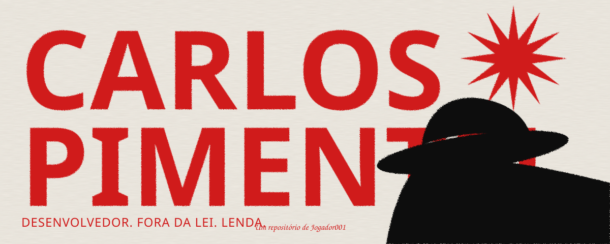
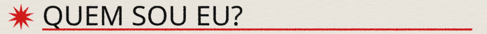
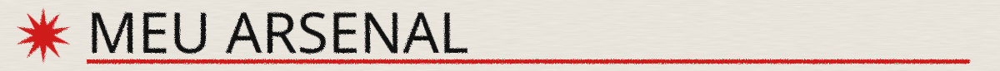
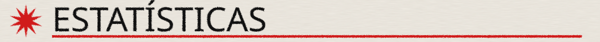
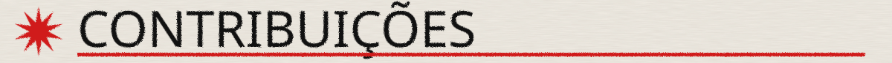
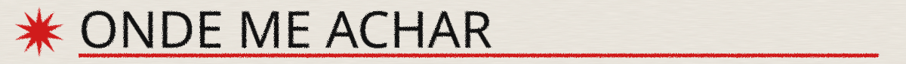
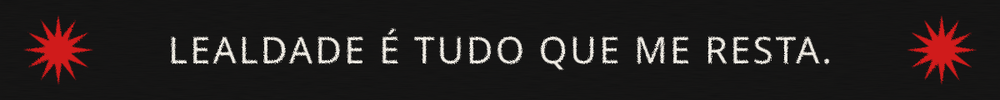

> **Num mundo que não o quer mais, ele simplesmente continua cavalgando.**

Sou **Carlos Daniel**, desenvolvedor web e freelancer. Transformo ideias em experiências digitais através de sites modernos, funcionais e responsivos, com foco em **HTML, CSS e JavaScript** e interesse em **UI Design**.

Estou sempre aprimorando minhas habilidades para construir projetos cada vez melhores.

- 🔴 Desenvolvimento web e criação de interfaces
- ⚪ Sites responsivos e modernos, do protótipo ao código
- ⚫ Aberto a projetos e colaborações

### O que eu desenvolvo

- 🌐 Sites institucionais
- 🚀 Landing pages
- 📱 Sites responsivos
- 🎨 Interfaces e protótipos no Figma
- 🏢 Páginas para empresas e pequenos negócios

Tem uma ideia ou precisa de um site para o seu negócio? Vamos conversar.

<!-- PORTFÓLIO: troque o # pelo link quando o site estiver no ar -->

<!-- REDES SOCIAIS: troque SEU_USUARIO e apague as que não usar -->

